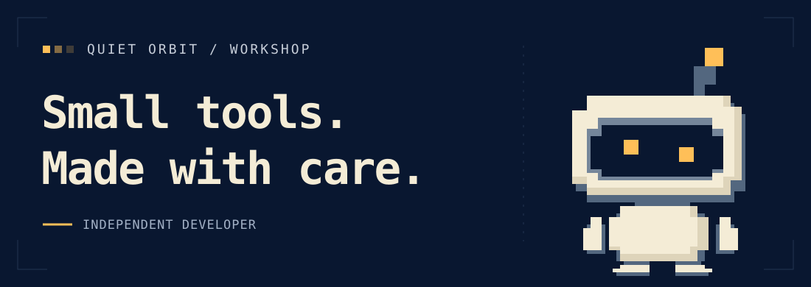

# Zemixo

Independent developer.

I turn small ideas into useful products and open-source tools.

### 01 / On the workbench

**[未完待续 · 这一刻，还来得及](https://tinyweblab.com)**

An interactive accident investigation. Find evidence, talk to characters, and explore how different choices change the outcome.

Interactive story · In Chinese

### 02 / Open-source tools

| Project | What it helps with |
| :--- | :--- |
| **[apple-presubmit-audit](https://github.com/zemixo/apple-presubmit-audit)** | Find common App Store submission issues, with rule explanations and JSON/SARIF reports. |
| **[claude-agent-ledger](https://github.com/zemixo/claude-agent-ledger)** | See where Claude Code agent costs go, using local session logs. |

### 03 / Say hello

Found a bug, have a question, or want to suggest something useful? Open an issue in the relevant repository.

---

Small tools. Made with care.
